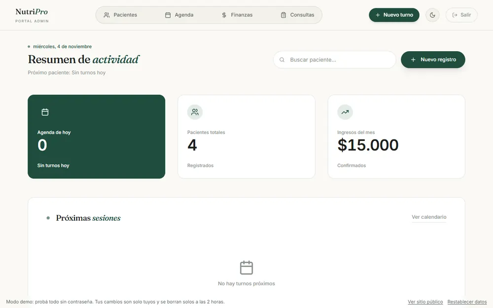
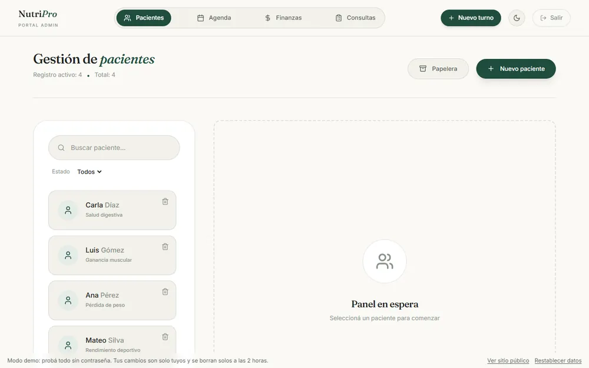
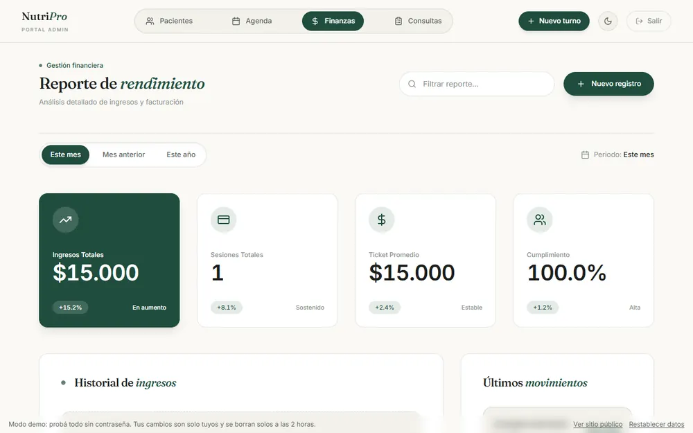
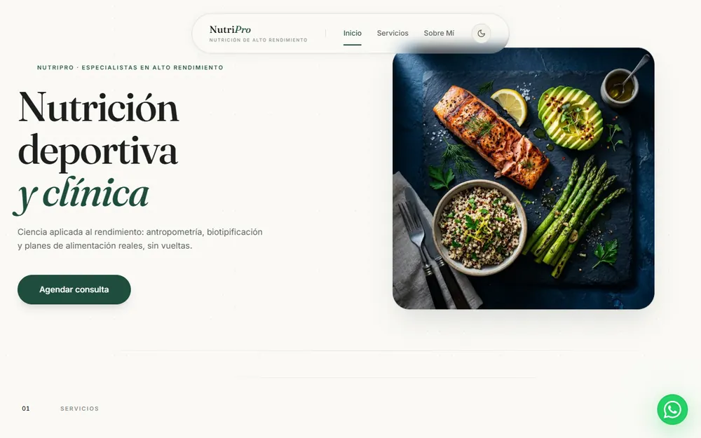

# Software de Nutrición

Plataforma de gestión para consultorios de nutrición deportiva y clínica: sitio público de cara al paciente y panel de administración completo para el profesional. Construido con Next.js 14 (App Router) y TypeScript.

Demo: https://nutrition-clinic-one.vercel.app. El panel está en `/admin` y en la demo se entra sin contraseña.

La demo le da a cada visitante sus propios datos y los borra solos. Esa parte no está en este repositorio.






Más trabajos en mi portfolio: https://portfolio-fawn-kappa-35.vercel.app

## Contenido

- **Sitio público** — landing, servicios, sobre mí, blog, calculadora metabólica, turnero de reservas online, contacto.
- **Panel de administración** (`/admin`) — dashboard, gestión de pacientes (altas, edición, papelera/archivado), agenda de turnos, finanzas, y consola clínica por paciente (anamnesis, antropometría, plan alimentario con buscador de alimentos, evolución con gráficos, notas, exportación a PDF).

### Acceso al panel

El usuario administrador se define con variables de entorno (ver `.env.example`):

```
ADMIN_EMAIL=admin@example.com
ADMIN_PASSWORD=<una-clave-segura>
```

## Decisiones técnicas

- Cuando alguien elige un horario, queda bloqueado 15 minutos. El bloqueo es una sola sentencia de PostgreSQL (`INSERT ... ON CONFLICT DO UPDATE`) que solo reemplaza un bloqueo si ya venció o es de la misma sesión. El código está en `app/api/appointments/lock`.
- Además del bloqueo, las reservas tienen una restricción única por fecha y hora en la base.
- El endpoint de bloqueo acepta 5 intentos por minuto por IP.
- Los pacientes se archivan en una papelera en vez de borrarse.
- El usuario administrador sale de variables de entorno (ver `.env.example`).

## Stack técnico

- **Framework:** Next.js 14 (App Router), React 18, TypeScript
- **Estilos:** Tailwind CSS v3 — sistema de diseño propio con tokens semánticos por CSS variables (modo claro/oscuro sin duplicar clases), tipografía Fraunces + Inter
- **Datos:** MongoDB / Mongoose (pacientes, consultas, notas, turnos) + PostgreSQL / Prisma (finanzas)
- **Auth:** NextAuth (credenciales)
- **Animaciones:** Framer Motion
- **Gráficos:** Recharts
- **Pagos:** Mercado Pago
- **Calendario:** Google Calendar API
- **PDF:** @react-pdf/renderer
- **PWA:** next-pwa

## Desarrollo local

```bash
npm install
npm run dev
```

La app queda disponible en `http://localhost:3005`.

### Variables de entorno

Creá un `.env.local` con:

```
MONGODB_URI=          # cadena de conexión MongoDB
DATABASE_URL=         # cadena de conexión PostgreSQL (Prisma)
NEXTAUTH_SECRET=      # generar con: openssl rand -hex 32
NEXTAUTH_URL=http://localhost:3005

# Opcionales según la funcionalidad que quieras probar
ADMIN_EMAIL=
ADMIN_PASSWORD=
MP_ACCESS_TOKEN=      # Mercado Pago
GOOGLE_CLIENT_EMAIL=  # Google Calendar
GOOGLE_PRIVATE_KEY=
GOOGLE_CALENDAR_ID=
USDA_API_KEY=         # búsqueda de alimentos USDA
```

## Build de producción

```bash
npm run build
npm start
```

## Deploy

Desplegado en [Vercel](https://vercel.com), con build y despliegue automático en cada push a `master`.
